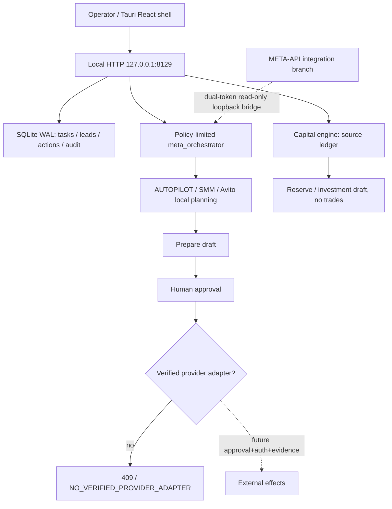

# SYNERGY AI WORKSPACE — научно-инженерный паспорт единого рабочего пространства

**24.10.2026 · Назначение:** локальное AI-пространство, объединяющее AUTOPILOT, SMM, Avito, Lead OS, финансовый учёт и безопасную оркестрацию. **Статус:** интеграционный прототип и неполный release candidate; **не** выпущенный production Windows EXE.

## 1. Главное разграничение веток

| Ветка | Содержимое | Что нельзя утверждать |
|---|---|---|
| [`main`](https://github.com/Shtenco/synergy_ai_workspace/tree/main) | Только прежний README | Нет полного приложения в main |
| [`release/v1.0-desktop-rc`](https://github.com/Shtenco/synergy_ai_workspace/tree/release/v1.0-desktop-rc) | Python `workspace/`, Tauri desktop shell, импортированные upstream/SMM/Avito файлы, тесты и release ledger | Windows NSIS release и полное GUI E2E не подтверждены |
| [`feat/hybrid-google-oracle-v1`](https://github.com/Shtenco/synergy_ai_workspace/tree/feat/hybrid-google-oracle-v1) | Те же основные модули и cloud readiness plan | Не означает существования реальной Oracle VM / GCP deployment |

**Идея проекта:** один локальный инструмент и один source of truth для задач, лидов, разрешений и финансовых записей. В реальном состоянии канонический backend — локальный Python HTTP control plane на `127.0.0.1:8129`, а не готовая публичная multi-tenant платформа.

## 2. Реальная технологическая архитектура



### Проверенные по исходникам функциональные границы

- [`workspace/service.py`](https://github.com/Shtenco/synergy_ai_workspace/blob/feat/hybrid-google-oracle-v1/workspace/service.py): `ThreadingHTTPServer`, local `127.0.0.1:8129`, bearer token, SQLite WAL, `tasks`, `leads`, `actions`, `audit`. Подготавливает черновик действия, фиксирует `approve`, а `execute_action` **отказывает** с `NO_VERIFIED_PROVIDER_ADAPTER`. Следовательно, кнопка одобрения не отправляет реальные сообщения автоматически.
- [`workspace/meta_orchestrator.py`](https://github.com/Shtenco/synergy_ai_workspace/blob/feat/hybrid-google-oracle-v1/workspace/meta_orchestrator.py): ограничение workflow 1–10 steps, allowlist внутренних capabilities, криптографический SHA256 результата для аудита. `external.avito.publish` и `external.investment.trade` в состоянии `blocked`.
- [`workspace/capital_engine.py`](https://github.com/Shtenco/synergy_ai_workspace/blob/feat/hybrid-google-oracle-v1/workspace/capital_engine.py): immutable `source_id` import, SHA-256 canonical JSON, отказ на конфликтном replay, целочисленные minor units, отсутствие смешения валют, явная маркировка `SOURCE_SUPPLIED_UNVERIFIED`. Наличие SHA не означает банковское подтверждение.
- [`desktop/`](https://github.com/Shtenco/synergy_ai_workspace/tree/feat/hybrid-google-oracle-v1/desktop): Tauri+React/Vite UI source, но Rust bootstrap `src-tauri/src/lib.rs` создаёт только базовую Tauri оболочку. Наличие frontend файлов не доказывает сборку установщика или прохождение native GUI E2E.
- [`vendor/avito_ai_combine/`](https://github.com/Shtenco/synergy_ai_workspace/tree/feat/hybrid-google-oracle-v1/vendor/avito_ai_combine): частично импортированный код, в котором несколько файлов имеют только десятки байт. По имени файла нельзя предполагать наличие полнофункционального агента.
- [`docs/HYBRID_CLOUD_DEPLOYMENT_RU.md`](https://github.com/Shtenco/synergy_ai_workspace/blob/feat/hybrid-google-oracle-v1/docs/HYBRID_CLOUD_DEPLOYMENT_RU.md): проектный план Google Cloud Run/Vertex AI + Oracle. Не факт развертывания.
- [`tests/test_http_e2e_v08.py`](https://github.com/Shtenco/synergy_ai_workspace/blob/feat/hybrid-google-oracle-v1/tests/test_http_e2e_v08.py): исходник локального HTTP E2E проверяет lead → draft → approval → **denied external execution** и отказ unauthenticated клиента. Этот тест не равен provider E2E.

## 3. Финансовая математика и учёт происхождения

Записи импортируются как `Decimal` текст с точностью до двух знаков и переводятся в `minor units`. Изолируются `income`, `expense`, `refund`, `transfer` и `investment`. Код **не** считает переводы новым доходом и не признаёт автоматически `refund` доходом.

$$
\Delta_t = \sum_{i\in income(t)} a_i-\sum_{j\in expense(t)}a_j.
$$

После установленного владельцем минимального буфера:

$$
S_t=\max(0,\max(0,\Delta_t)-B_t),\quad
R_t=\operatorname{round}_{minor}(S_t \,p_{reserve}/100),
$$

$$
I_t=\operatorname{round}_{minor}((S_t-R_t)p_{invest}/100).
$$

Это **только draft investment allocation**, а не торговый ордер. Входной статус `verified_by_bank: false` не повышается от вычисления hash или локального импорта.

### Сохранение финансовой целостности

`source_id` и `entry_id` являются уникальными. Импорт того же canonical contents игнорируется, импорт другого payload с тем же `source_id` отвергается. Валюта — отдельно по ISO code, нет неявной FX конверсии. Финансовые расчёты нельзя связывать с внешними транзакциями, пока не появятся подписанные факты поступления, сверка с банком и owner approval.

## 4. Модель исполнения и безопасность

```text
lead discovered != buyer verified
draft created != provider action
operator approval != adapter execution
model plan != money movement
hash of local data != external bank attestation
frontend screen != deployed backend
CI workflow present != green release
```

**Существующий local bearer-token backend нельзя публиковать как общий SaaS.** Перед production требуются OIDC/MFA, tenant isolation/RBAC, CSRF и CORS review, state transition authorization, robust audit storage, secret vault, transport encryption, retention/deletion procedures, operator-visible consent и idempotency keys для внешних действий. Нельзя помещать учётные записи Avito/SMM или оригинальные персональные экспорты в публичный GitHub.

## 5. Локальное воспроизведение исходной ветки

```bash
git clone https://github.com/Shtenco/synergy_ai_workspace.git
cd synergy_ai_workspace
git switch feat/hybrid-google-oracle-v1
python -m pip install -r requirements.txt
python -m pytest -q
python scripts/check_cloud_readiness.py .
```

**Внимание:** `check_cloud_readiness.py` проверяет только существование исходников и локальную bind-строку — не обращается к OCI/GCP, не проверяет доступность VM, TLS или live IAM. Команды тестирования здесь — инструкция; новый выполненный прогон не заявляется.

Локальный API:

```bash
python -m workspace.service
```

В обычной разработке следует задать `SYNERGY_TOKEN` в приватной среде и не копировать его в репозиторий. Backend по умолчанию ограничен loopback. Сборка Tauri — отдельный этап с Node/Rust/Windows toolchain и настоящими package/e2e gates; наличие bat-файла не доказывает установщик.

## 6. Фальсифицируемые критерии готовности

| Объект | Проверка | Ожидаемый результат |
|---|---|---|
| Доступ | GET без bearer token | 401 |
| Identity / multi-tenant | Org A вызывает данные Org B | Пока нет приемочного теста; production заблокирован |
| Side effects | Approve → execute без verified provider | 409, `external_effects=false` |
| Retry | Два одинаковых импорта source | Нет двойной записи |
| Conflict | Один source_id + другая SHA | `SOURCE_CONFLICT` |
| Accounting | Transfer/refund отдельно от income | Реальный денежный баланс не завышен |
| Cloud | OCI и private Cloud Run с IAM | Нет подтверждения |
| Desktop | Installer SHA + native Windows E2E | Нет подтверждения |
| Complete integration | AUTOPILOT + SMM + AVITO с внешним provider dry-run → verified live | Не доказано |

Рубеж **GREEN** требует реальный build artifact, зафиксированный commit и журнал CI, native GUI smoke/e2e, sandbox provider tests, source provenance и независимый security review.

## 7. История и инженерный план

V0.1 была оболочкой интеграции; V0.2–V0.9 описаны в отдельных `README_V02.md` ... `README_V09.md` на ветке; V1.0 RC пока имеет незакрытые блокеры, подробно отмеченные в [`RELEASE_CANDIDATE_STATUS.md`](https://github.com/Shtenco/synergy_ai_workspace/blob/feat/hybrid-google-oracle-v1/RELEASE_CANDIDATE_STATUS.md).

Следующий шаг — не объявлять готовое EXE, а обеспечить одно reproducible source tree, pinned dependencies, защищённую сборку Windows, автоматизированный local HTTP E2E, проверенное подключение META-API через dual-token read-only bridge и только потом отдельный контролируемый режим реальных действий.

**Стандарт:** [SYNERGY SYSTEM](https://github.com/Shtenco/synergy_system) · [Research example REVERSE-EXP](https://github.com/Shtenco/dlp_solver). Оригинальная документация и исторические ветки сохраняются.

---

## Предыдущий README (история сохранена)

# SYNERGY AI WORKSPACE

Unified desktop integration of SYNERGY AI AUTOPILOT, AI-SMM and AI-AVITO.

> **Status: release-candidate integration in progress.** Windows installation, native GUI E2E, live OAuth and provider execution are not yet verified.

## Authoritative sources

- [AUTOPILOT Rust/Tauri integration](https://github.com/Shtenco/synergy_agi_autopilot/tree/integration/synergy-ai-autopilot-v1)
- [AUTOPILOT Python capabilities](https://github.com/Shtenco/synergy_agi_autopilot/tree/feat/capability-runtime-v1)
- [AI-SMM original UI](https://github.com/Shtenco/synergy.github.io/tree/main/smm)
- AI-AVITO original code: provided separately in `AVITO_AI_COMBINE_V1_BUSINESS_AUTOPILOT(1).zip`; DO NOT upload live credentials or personal datasets.

## Safety and release gates

External sending is disabled by default. Require authenticated operator approval, platform-specific API authorization, idempotency and audit evidence before any real external side effects. Source presence is not sufficient to claim a working integration.

The RC branch should contain the complete sanitized source tree and reproducible Windows CI; do not publish a release until the installer and desktop E2E checks are verified.
